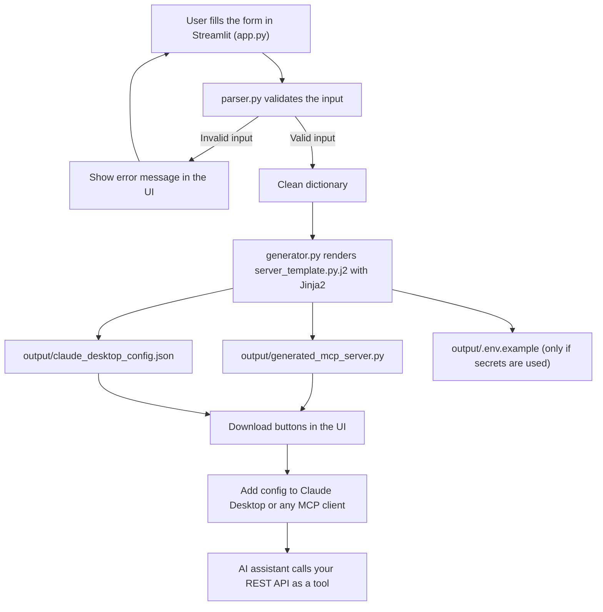

<div align="center">

# 🔌 api-to-mcp-generator

**Turn any basic REST API endpoint into a ready-to-run MCP server, with no manual server coding.**

[](https://www.python.org/)
[](https://modelcontextprotocol.io/)
[](https://streamlit.io/)
[](https://jinja.palletsprojects.com/)
[](https://requests.readthedocs.io/)
[](https://github.com/theskumar/python-dotenv)


</div>

---

## 📖 Overview

`api-to-mcp-generator` is a beginner-friendly, open-source Python tool. You describe a REST API endpoint in a simple Streamlit form, and the tool generates:

1. A working **MCP server** (`generated_mcp_server.py`) built with the official `FastMCP` SDK.
2. A matching **Claude Desktop config** (`claude_desktop_config.json`).

Once connected, an AI assistant such as Claude can call your API as a tool.

## ✨ Features

- Simple Streamlit web interface, no coding needed to generate a server
- Supports **GET** and **POST** requests
- Custom **headers**, **query parameters** and **JSON body parameters**
- Input validation with clear, friendly error messages
- **Secrets stay out of your code**: API keys use `${ENV_VAR}` placeholders loaded through `os.getenv()` or a `.env` file
- Download both generated files with one click
- Clean, readable code written for learners

## 🧰 Tech Stack

| Technology | Purpose |
|---|---|
| Python 3.10+ | Core language |
| `mcp` (FastMCP) | Official MCP Python SDK used by the generated server |
| Jinja2 | Renders the server template |
| Streamlit | Web UI |
| requests | HTTP calls made by the generated server |
| python-dotenv | Loads secrets from a `.env` file |

## 🔄 How It Works



## 📁 Project Structure

```
api-to-mcp-generator/
├── app.py                          Streamlit user interface
├── requirements.txt                Python dependencies
├── README.md
├── src/
│   ├── __init__.py
│   ├── parser.py                   Validates user input
│   ├── generator.py                Renders template and writes output files
│   └── templates/
│       └── server_template.py.j2   Jinja2 template for the MCP server
└── output/                         Created automatically after generating
    ├── generated_mcp_server.py
    ├── claude_desktop_config.json
    └── .env.example
```

## 🚀 Getting Started

### Prerequisites

- Python **3.10 or newer**
- `pip`
- (Optional) Node.js, only if you want to test with MCP Inspector
- (Optional) Claude Desktop

### Installation

```bash
git clone https://github.com/rriyansh/api-to-mcp-generator.git
cd api-to-mcp-generator

python -m venv venv
```

Activate the virtual environment:

```bash
# Windows
venv\Scripts\activate

# macOS / Linux
source venv/bin/activate
```

Install dependencies:

```bash
pip install -r requirements.txt
```

> **Note:** `requirements.txt` pins `mcp<2` because `mcp` 2.x renamed `FastMCP`, which would break the generated servers.

### Run the App

```bash
streamlit run app.py
```

Your browser opens the generator UI, usually at `http://localhost:8501`.

## 🧭 Usage

1. Fill in the form.
2. Click **Generate MCP Server**.
3. Download `generated_mcp_server.py` and `claude_desktop_config.json` (they are also saved in `output/`).

### Form Fields

| Field | Description | Example |
|---|---|---|
| Tool name | Python-style name (letters, numbers, underscores) | `get_posts` |
| Tool description | What the tool does, shown to the AI | `Fetch posts, optionally filtered by user id` |
| API URL | Full `http://` or `https://` endpoint | `https://jsonplaceholder.typicode.com/posts` |
| HTTP method | `GET` or `POST` | `GET` |
| Headers | One per line, `Name: value` | `Accept: application/json` |
| Parameters | One per line, `name, type, location, required` | `userId, integer, query, no` |

**Parameter format**

- `type`: `string`, `integer`, `number` or `boolean`
- `location`: `query` or `body` (GET requests support `query` only)
- `required`: `yes` or `no`

Missing parts use defaults: type `string`, location `query`, required `yes`.

## 🔐 Handling API Keys Safely

Never type a real key into the form. Use a placeholder in the header value:

```
Authorization: Bearer ${API_TOKEN}
```

The generator will reject secret headers (such as `Authorization` or `X-API-Key`) that do not use a placeholder. After generating, create a `.env` file **next to** `generated_mcp_server.py`:

```
API_TOKEN=your_real_token_here
```

The server reads it at runtime with `os.getenv()`. Never commit your `.env` file.

## 🧪 Try It with Free Public APIs

### Example 1: JSONPlaceholder (GET)

| Field | Value |
|---|---|
| Tool name | `get_posts` |
| URL | `https://jsonplaceholder.typicode.com/posts` |
| Method | `GET` |
| Parameters | `userId, integer, query, no` |

### Example 2: Open-Meteo Weather (GET)

| Field | Value |
|---|---|
| Tool name | `get_weather` |
| URL | `https://api.open-meteo.com/v1/forecast` |
| Method | `GET` |
| Parameters | `latitude, number, query, yes`<br>`longitude, number, query, yes`<br>`current_weather, string, query, no` |

Test input: `latitude=52.52`, `longitude=13.41`, `current_weather=true`

### Example 3: JSONPlaceholder (POST)

| Field | Value |
|---|---|
| Tool name | `create_post` |
| URL | `https://jsonplaceholder.typicode.com/posts` |
| Method | `POST` |
| Headers | `Content-Type: application/json` |
| Parameters | `title, string, body, yes`<br>`body, string, body, yes`<br>`userId, integer, body, yes` |

## 🔍 Testing the Generated Server

**1. Quick check.** Run the server directly. It should start and wait silently for input (press `Ctrl+C` to stop):

```bash
python output/generated_mcp_server.py
```

**2. MCP Inspector.** Test your tool in the browser (requires Node.js):

```bash
npx @modelcontextprotocol/inspector python output/generated_mcp_server.py
```

**3. Claude Desktop.** Merge the generated `mcpServers` block into your Claude Desktop config file, then restart Claude Desktop:

| OS | Config file location |
|---|---|
| macOS | `~/Library/Application Support/Claude/claude_desktop_config.json` |
| Windows | `%APPDATA%\Claude\claude_desktop_config.json` |

Example of the generated config:

```json
{
  "mcpServers": {
    "get_weather": {
      "command": "/path/to/your/venv/bin/python",
      "args": [
        "/path/to/api-to-mcp-generator/output/generated_mcp_server.py"
      ]
    }
  }
}
```

The paths are absolute and specific to your machine, so generate the config on the same computer where Claude Desktop runs.

## ⚠️ Current Limitations (Level 1)

- Only **GET** and **POST** are supported
- Parameter names must be valid Python names (`user_id` works, `user-id` does not)
- No path parameters such as `/posts/{id}` yet
- One tool per generated server

## 🗺️ Roadmap

- [ ] PUT, PATCH and DELETE methods
- [ ] Path parameters (`/posts/{id}`)
- [ ] Multiple tools in one server
- [ ] Authentication presets (Bearer, API key, Basic)
- [ ] Import from OpenAPI / Swagger files
- [ ] Automated tests and CI

## 🤝 Contributing

Contributions are welcome, especially from fellow beginners!

1. Fork the repository
2. Create a branch: `git checkout -b feature/your-feature`
3. Commit your changes: `git commit -m "Add your feature"`
4. Push the branch: `git push origin feature/your-feature`
5. Open a Pull Request

Please keep the code simple and readable.

## 📄 License

Add a `LICENSE` file to your repository (MIT is a popular choice for open-source projects) and update this section to match.

## 🙏 Acknowledgements

- [Model Context Protocol](https://modelcontextprotocol.io/)
- [Streamlit](https://streamlit.io/)
- [Jinja2](https://jinja.palletsprojects.com/)

---

<div align="center">

Made with ❤️ by [rriyansh](https://github.com/rriyansh)

If this project helped you, please give it a ⭐

</div>
