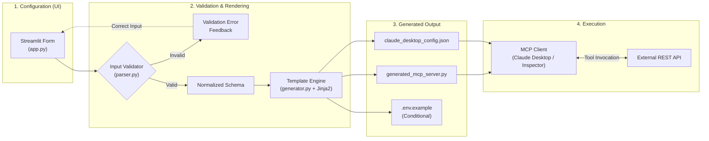

<div align="center">

# api-to-mcp-generator

**Convert any REST API endpoint into a production-ready Model Context Protocol (MCP) server without manual boilerplate coding.**

[](https://www.python.org/)
[](https://modelcontextprotocol.io/)
[](https://streamlit.io/)
[](https://jinja.palletsprojects.com/)
[](https://requests.readthedocs.io/)
[](https://github.com/theskumar/python-dotenv)

[](#roadmap)
[](#license)
[](#contributing)

</div>

---

## Overview

`api-to-mcp-generator` is an open-source Python utility that automates the creation of Model Context Protocol (MCP) servers from standard REST API specifications. By defining an endpoint through a Streamlit web interface, the tool validates inputs and generates:

1. **MCP Server (`generated_mcp_server.py`)**: A standalone Python server built on the official `FastMCP` SDK.
2. **Client Configuration (`claude_desktop_config.json`)**: A ready-to-merge configuration file for Claude Desktop and compatible MCP clients.
3. **Environment Template (`.env.example`)**: Automatically generated when environment variable placeholders are detected in headers.

Once configured, AI assistants can invoke your REST API endpoints natively as structured tools.

---

## Key Features

- **Zero-Boilerplate Generation**: Configure endpoints, parameters, and headers via a structured web interface.
- **HTTP Method Support**: Native handling for `GET` and `POST` requests.
- **Flexible Parameter Mapping**: Define custom HTTP headers, URL query parameters, and JSON request bodies with type enforcement (`string`, `integer`, `number`, `boolean`).
- **Strict Input Validation**: Pre-generation schema and syntax checks prevent runtime failures in the generated server.
- **Secure Credential Management**: Enforces `${ENV_VAR}` placeholders for sensitive headers, loading secrets at runtime via `python-dotenv` and `os.getenv()`.
- **One-Click Export**: Download generated artifacts directly from the UI or access them from the local `output/` directory.

---

## Technology Stack

| Component | Technology | Role |
| :--- | :--- | :--- |
| **Core Runtime** |  `Python 3.10+` | Core application logic and generated server runtime |
| **MCP Framework** |  `mcp (FastMCP)` | Official MCP Python SDK powering the generated tool server |
| **Web Interface** |  `Streamlit` | Interactive browser-based configuration UI |
| **Code Generation** |  `Jinja2` | Template engine for rendering clean Python server code |
| **HTTP Client** |  `requests` | Outbound REST API execution within the generated server |
| **Secret Management** |  `python-dotenv` | Environment variable injection from local `.env` files |

---

## Architecture & Workflow



---

## Project Structure

```text
api-to-mcp-generator/
├── app.py                          # Streamlit web application entry point
├── requirements.txt                # Pinned Python dependencies
├── README.md                       # Project documentation
├── src/
│   ├── __init__.py
│   ├── parser.py                   # Input validation and schema normalization
│   ├── generator.py                # Jinja2 rendering and file output management
│   └── templates/
│       └── server_template.py.j2   # Base template for generated FastMCP servers
└── output/                         # Auto-created directory for generated artifacts
    ├── generated_mcp_server.py
    ├── claude_desktop_config.json
    └── .env.example
```

---

## Getting Started

### Prerequisites

- **Python**: Version 3.10 or higher
- **pip**: Python package installer
- **Node.js** *(Optional)*: Required only if testing with the official MCP Inspector
- **Claude Desktop** *(Optional)*: Required for local AI assistant integration

### Installation

1. **Clone the repository:**

   ```bash
   git clone [https://github.com/rriyansh/api-to-mcp-generator.git](https://github.com/rriyansh/api-to-mcp-generator.git)
   cd api-to-mcp-generator
   ```

2. **Create and activate a virtual environment:**

   ```bash
   python -m venv venv
   ```

   - **Windows:**
     ```bash
     venv\Scripts\activate
     ```
   - **macOS / Linux:**
     ```bash
     source venv/bin/activate
     ```

3. **Install dependencies:**

   ```bash
   pip install -r requirements.txt
   ```

   > **Note:** `requirements.txt` pins `mcp<2` to maintain compatibility with `FastMCP` import paths used in the server template.

### Running the Application

Launch the Streamlit interface:

```bash
streamlit run app.py
```

The interface will open automatically in your default browser at `http://localhost:8501`.

---

## Usage Guide

1. Enter the endpoint metadata, headers, and parameters in the web form.
2. Select **Generate MCP Server**.
3. Download `generated_mcp_server.py` and `claude_desktop_config.json` directly from the UI (files are also persisted in `output/`).

### Configuration Fields

| Field | Specification | Example |
| :--- | :--- | :--- |
| **Tool Name** | Valid Python identifier (`a-z`, `0-9`, `_`) | `get_posts` |
| **Tool Description** | Semantic summary used by the LLM to select the tool | `Fetch posts, optionally filtered by user ID` |
| **API URL** | Complete `http://` or `https://` endpoint URL | `https://jsonplaceholder.typicode.com/posts` |
| **HTTP Method** | `GET` or `POST` | `GET` |
| **Headers** | One per line (`Key: Value`) | `Accept: application/json` |
| **Parameters** | One per line (`name, type, location, required`) | `userId, integer, query, no` |

#### Parameter Syntax Rules

- **`type`**: `string`, `integer`, `number`, or `boolean` *(default: `string`)*
- **`location`**: `query` or `body` *(default: `query`; `GET` requests restrict parameters to `query`)*
- **`required`**: `yes` or `no` *(default: `yes`)*

---

## Security & Secret Management

Do not enter raw API keys or tokens into the web form. Reference environment variables using `${VAR_NAME}` syntax within header values:

```text
Authorization: Bearer ${API_TOKEN}
```

The validator automatically rejects sensitive headers (such as `Authorization` or `X-API-Key`) that contain hardcoded values. After generating your server, create a `.env` file in the same directory as `generated_mcp_server.py`:

```env
API_TOKEN=your_actual_api_key_here
```

The generated server loads these variables at runtime via `python-dotenv`. Ensure `.env` is excluded from version control.

---

## Example Configurations

### 1. JSONPlaceholder — Fetch Posts (`GET`)

| Field | Value |
| :--- | :--- |
| **Tool Name** | `get_posts` |
| **API URL** | `https://jsonplaceholder.typicode.com/posts` |
| **HTTP Method** | `GET` |
| **Parameters** | `userId, integer, query, no` |

### 2. Open-Meteo — Weather Forecast (`GET`)

| Field | Value |
| :--- | :--- |
| **Tool Name** | `get_weather` |
| **API URL** | `https://api.open-meteo.com/v1/forecast` |
| **HTTP Method** | `GET` |
| **Parameters** | `latitude, number, query, yes`<br>`longitude, number, query, yes`<br>`current_weather, string, query, no` |

*Sample test payload:* `latitude=52.52`, `longitude=13.41`, `current_weather=true`

### 3. JSONPlaceholder — Create Post (`POST`)

| Field | Value |
| :--- | :--- |
| **Tool Name** | `create_post` |
| **API URL** | `https://jsonplaceholder.typicode.com/posts` |
| **HTTP Method** | `POST` |
| **Headers** | `Content-Type: application/json` |
| **Parameters** | `title, string, body, yes`<br>`body, string, body, yes`<br>`userId, integer, body, yes` |

---

## Testing & Deployment

### 1. Standalone Execution Check

Verify that the server initializes without syntax or import errors (press `Ctrl+C` to terminate):

```bash
python output/generated_mcp_server.py
```

### 2. Interactive Testing via MCP Inspector

Test tool discovery and live API execution in a browser interface (requires Node.js):

```bash
npx @modelcontextprotocol/inspector python output/generated_mcp_server.py
```

### 3. Claude Desktop Integration

Merge the contents of `output/claude_desktop_config.json` into your local Claude Desktop configuration file and restart the application:

| Operating System | Configuration File Path |
| :--- | :--- |
| **macOS** | `~/Library/Application Support/Claude/claude_desktop_config.json` |
| **Windows** | `%APPDATA%\Claude\claude_desktop_config.json` |

**Example Configuration:**

```json
{
  "mcpServers": {
    "get_weather": {
      "command": "/absolute/path/to/venv/bin/python",
      "args": [
        "/absolute/path/to/api-to-mcp-generator/output/generated_mcp_server.py"
      ]
    }
  }
}
```

> **Note:** Generated paths are absolute to the host filesystem. Run the generator on the target machine where Claude Desktop is installed.

---

## Current Limitations (Level 1)

- HTTP method support is restricted to `GET` and `POST`.
- Parameter names must conform to valid Python variable identifiers (e.g., `user_id` is valid; `user-id` is not).
- Dynamic URL path parameters (e.g., `/posts/{id}`) are not yet supported.
- Each generation cycle outputs a single-tool MCP server.

---

## Roadmap

- [ ] Support for `PUT`, `PATCH`, and `DELETE` HTTP methods
- [ ] Dynamic path parameter interpolation (e.g., `/users/{user_id}`)
- [ ] Multi-tool aggregation within a single generated MCP server
- [ ] Built-in authentication presets (Bearer Token, API Key, Basic Auth)
- [ ] OpenAPI / Swagger specification import
- [ ] Automated unit test suite and GitHub Actions CI pipeline

---

## Contributing

Contributions are welcome. To propose changes:

1. Fork the repository.
2. Create a feature branch (`git checkout -b feature/your-feature-name`).
3. Commit your changes with clear, descriptive messages (`git commit -m "Add support for PUT requests"`).
4. Push to your fork (`git push origin feature/your-feature-name`).
5. Open a Pull Request detailing your changes.

Please ensure all code remains clean, modular, and well-documented.

---

## License

This project is open source. Add a `LICENSE` file (such as the [MIT License](https://opensource.org/licenses/MIT)) to the root directory and update this section accordingly.

---

## Acknowledgements

- [Model Context Protocol (MCP)](https://modelcontextprotocol.io/)
- [Streamlit](https://streamlit.io/)
- [Jinja2](https://jinja.palletsprojects.com/)

---

<div align="center">

Maintained by [rriyansh](https://github.com/rriyansh)

</div>
